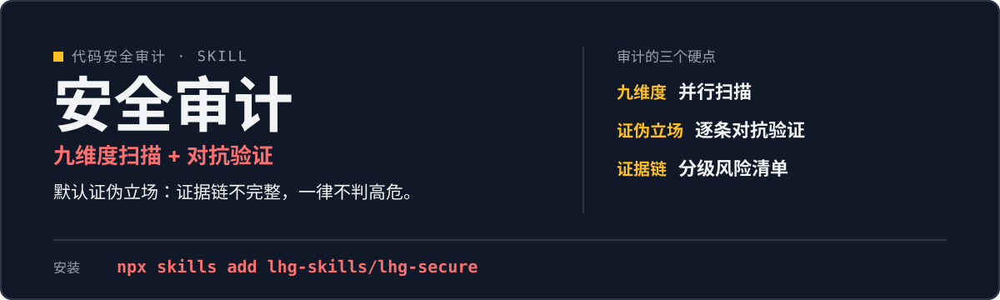

<p align="center">
  
</p>

# lhg-secure · 代码安全审计

代码安全审计：建上下文 → 九维度并行扫描 → 对抗验证 → 分级报告四步流程，默认证伪立场逐条推翻候选，输出带证据链的分级风险清单、误报说明与覆盖率声明。

（SKILL.md v1.1.1）

## 它是什么

- 四步流程：建上下文（业务与信任边界）→ 九维度并行扫描 → 对抗验证 → 分级报告。
- 默认证伪立场：看到 `eval`、`shell=True` 先记候选不判罪，证据链写不完整一律不判高危。
- 输出分级风险清单、误报说明与覆盖率声明。

## 先试一句

| 你说 | 它给你 |
|---|---|
| 审计这段代码 | 先建上下文，再九维度并行扫描 |
| 扫一下有没有漏洞 | 候选逐条对抗验证，只交付证据链完整的结论 |
| 上线前安全评审 | 分级风险清单 + 误报说明 + 覆盖率声明 |

## 安装

```bash
npx skills add lhg-skills/lhg-secure
```

<details>
<summary>发给 Agent 的安装话术（推荐：小白用户直接复制整段发给你的 Agent）</summary>

> 请帮我安装 Skill「lhg-secure」：先从 Gitee 上 lhg-skills 组织下的 lhg-secure 仓库下载；如果 Gitee 无法访问或下载失败，改从 GitHub 上 lhg-skills 组织下的同名仓库下载。按当前 Agent 的规范安装其中的 Skill，优先全局安装，保留完整目录和依赖。请直接执行，完成后验证是否安装成功，告诉我实际使用的来源、安装的版本号以及如何调用；遇到访问或安装限制请说明具体原因。需要输入管理员密码或确认风险时停下来等我。

**怎么算装好了**：Agent 能在已安装的 Skill 里看到 `lhg-secure`，并报出版本号（与仓库 `SKILL.md` 的 `version` 一致）。只是打开了仓库网页不算安装。

</details>


## 它怎么做

1. 建上下文
2. 九维度并行扫描
3. 对抗验证（证伪立场）
4. 分级报告（风险清单 + 误报说明 + 覆盖率声明）

## 什么时候用 / 不用

**用它，当你：**

- 上线前安全评审、代码审计、扫漏洞
- 要证据链完整的结论
- 要分级清单知道先修哪个

**别用它，当你：**

- 要定罪式扫描——默认证伪，不做有罪推定
- 证据链不完整还想判高危——写不完整一律不判高危
- 把它当漏洞利用工具——它只做审计

## 目录结构

```
SKILL.md            skill 全文
references/
  dimensions-cheatsheet.md  九维度速查表
  false-positive-guide.md   误报处理指南
  smoke-test.md           自检用例（4 个）
  fixtures/               2 个对照用例
LICENSE             MIT
manifest.yaml
icon-512.png
```

## 自检与反馈

按 [references/smoke-test.md](references/smoke-test.md) 跑 4 个用例：按四步流程对 fixture 实际审计一次，输出 5 条 finding，不多不少。

发现问题请提 issue：[提一个 issue](https://github.com/lhg-skills/lhg-secure/issues/new)（标题以 `[QC] ` 开头，写清你让它做了什么、它实际给了什么）。

---

## 出品：刘洪光

本 skill 由真人出镜 IP「刘洪光」（安徽合肥）出品，归属 [lhg-skills](https://github.com/lhg-skills)。

- GitHub 主页：https://github.com/lhg-skills —— 全部 skill 开源在此，欢迎 star
- 抖音：搜「刘老师讲AI实战」
- 微信：lhgsmsw

觉得有用，欢迎点 ⭐ Star。
